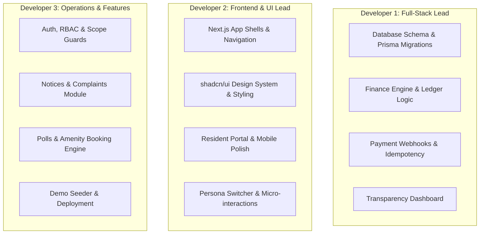

# SocietyHub — Hackathon Implementation Plan

> **Project:** SocietyHub — Modern Housing Society Management Platform  
> **Source Documents:** [`plan_society.md`](file:///d:/Hackathons/Code%20Apex/plan_society.md) & [`tech_stack_society.md`](file:///d:/Hackathons/Code%20Apex/tech_stack_society.md)  
> **Target:** Hackathon Execution & Live Judge Demonstration  
> **Format:** 7 Phased Milestones with Actionable Tasks, P0/P1/P2 Prioritization, Tech Stack Mapping, and Demo Verification Checklists.

---

## Executive Summary & Hackathon Strategy

Housing societies in India face chaos due to unsegregated funds, informal WhatsApp governance, untracked cash collections, and zero wing-level privacy. 

For a hackathon, building a full 26-week enterprise software suite is impossible; however, **delivering a cohesive, end-to-end, role-aware application with a bulletproof financial ledger, wing isolation, and a killer live demo is a winning formula.**

### The Winning Demo Journey (6-Minute Judge Walkthrough)
1. **Persona Switcher:** 1-click toggle between **Chairman Sharma** (Society-wide god-view), **Wing Rep Patel** (Wing A isolation), and **Resident Verma** (Flat A-402 Owner).
2. **Financial Transparency & Ledger:** Resident views itemized bill (Maintenance ₹3,000, Sinking ₹1,000, Club ₹500), pays via mock Razorpay/UPI gateway, and watches the **society fund-head ledger update in real-time** with an auto-generated PDF receipt.
3. **Wing-Level Isolation:** Wing Rep Patel posts an urgent Wing A elevator maintenance notice; Resident Verma sees it in their Wing Hub. Switch to Wing B resident—it does not exist in their feed.
4. **Democratic Governance:** Chairman initiates an AGM resolution poll ("Approve Solar Panel Installation"); Resident Verma casts their flat's tamper-evident vote; live quorum & bar chart tally updates immediately.
5. **Conflict-Free Amenity Booking:** Resident books the Clubhouse hall for Saturday; system validates dues clearance and locks out conflicting slots via database-level conflict guards.

---

## Phase Overview at a Glance

```mermaid
gantt
    title SocietyHub Hackathon Execution Timeline (48-Hour Sprint Model)
    dateFormat  HH
    axisFormat %H h

    section Foundations
    Phase 0 Monorepo, DB & Demo Seeder       :crit, p0, 00, 5h
    Phase 1 Identity, RBAC & Wing Guard     :p1, after p0, 6h

    section Core Engines
    Phase 2 Financial Ledger & Payment Flow :crit, p2, after p1, 10h
    Phase 3 Notices & Complaint Lifecycle   :p3, after p2, 7h

    section Governance & Amenities
    Phase 4 Voting, Meetings & Amenities    :p4, after p3, 8h

    section Polish & Pitch
    Phase 5 Design System & Micro-animations:p5, after p4, 6h
    Phase 6 Deployment & Live Pitch Script  :crit, p6, after p5, 6h
```

| Phase | Milestone Name | Hackathon Target | Primary Modules | Key Deliverables |
|:---:|:---|:---|:---:|:---|
| **0** | **Monorepo Setup & Data Foundation** | Hours 0 – 5 | Core Infra | Turborepo, NestJS + Next.js scaffolding, PostgreSQL schema, rich realistic DB seed, Persona Switcher |
| **1** | **Identity, RBAC & Wing Isolation** | Hours 5 – 11 | M1, M3, M4 | Auth bypass/OTP, JWT, Scope Guard, Resident & Admin layout shells, Wing data filtering |
| **2** | **Finance Engine & Transparency** | Hours 11 – 21 | M2 | Fund heads, billing run, append-only ledger, payment intent/webhook simulation, PDF receipts, transparency chart |
| **3** | **Notices & Complaint Lifecycles** | Hours 21 – 28 | M5, M6, M10 | Notice board with targeting, versioned rules, complaint ticket timeline with SLA badge & comments |
| **4** | **Governance, Polls & Amenities** | Hours 28 – 36 | M7, M8, M9 | Tamper-proof unit polls, AGM RSVP & minutes, conflict-free amenity calendar with fee posting |
| **5** | **UI/UX Polish & Micro-Interactions** | Hours 36 – 42 | Full UI | shadcn/ui styling, responsive mobile bottom-bar, Recharts dashboards, skeleton loaders, zero placeholders |
| **6** | **Live Deployment & Pitch Mastery** | Hours 42 – 48 | DevOps & Demo | Staging deploy (Vercel/Railway), video fallback, 3-minute pitch deck, judge test script |

---

## Detailed Implementation Phases

---

### Phase 0: Monorepo Setup, Data Foundation & Demo Seeder (Hours 0 – 5)

> **Objective:** Establish an industrial-grade monorepo, set up database models, and write a rich seed script so the frontend never looks empty.

#### Task Breakdown

- [ ] **Task 0.1: Monorepo Scaffolding** `[P0]`
  - Initialize Turborepo with `pnpm`:
    - `apps/web`: Next.js 14+ (App Router, Tailwind CSS, Lucide React, shadcn/ui).
    - `apps/api`: NestJS 10+ with TypeScript strict mode.
    - `packages/shared`: Shared TypeScript types, Zod schemas, constants, and currency utilities.
  - Setup root scripts: `pnpm dev`, `pnpm build`, `pnpm lint`.
- [ ] **Task 0.2: Containerized Database & Cache** `[P0]`
  - Create [`docker-compose.yml`](file:///d:/Hackathons/Code%20Apex/infra/docker-compose.yml) running:
    - PostgreSQL 16 (with `pgcrypto` and `btree_gist`).
    - Redis 7 (for queues and session rate limits).
- [ ] **Task 0.3: Prisma Schema Definition** `[P0]`
  - Define core relational models in `apps/api/prisma/schema.prisma`:
    - `Society`, `Wing`, `Unit`, `User`, `UnitMembership`.
    - `Role`, `Permission`, `RoleAssignment` (`scope_type`, `scope_id`).
    - `Fund`, `ChargeRule`, `BillingCycle`, `Invoice`, `InvoiceLine`.
    - `Payment`, `PaymentAllocation`, `LedgerEntry`.
    - `Notice`, `NoticeTarget`, `Complaint`, `ComplaintEvent`.
    - `Meeting`, `Poll`, `PollOption`, `Vote`.
    - `Amenity`, `Booking`, `AuditLog`.
- [ ] **Task 0.4: Realistic Hackathon Database Seeder (`seed.ts`)** `[P0]`
  - Create a realistic dummy society: **"Apex Heights Co-operative Housing Society"** (Registration: BOM/HSG/1402/2018).
  - Pre-populate:
    - 2 Wings: **Wing A** (10 floors, 20 flats) and **Wing B** (10 floors, 20 flats).
    - 4 Pre-configured Demo Users:
      1. `chairman@apex.com` (Rajesh Sharma — Chairman, Society scope).
      2. `wingrep.a@apex.com` (Sunita Patel — Wing Rep, Wing A scope).
      3. `resident.a402@apex.com` (Amit Verma — Owner, Flat A-402).
      4. `tenant.b101@apex.com` (Karan Rao — Tenant, Flat B-101).
    - 4 Separate Fund Heads: *General Maintenance*, *Sinking Fund*, *Clubhouse & Sports*, *Major Repairs*.
    - Existing billing history: 2 past paid billing cycles with ledger entries, and 1 current pending cycle with ₹4,500 due for Flat A-402.
    - 3 active notices, 2 sample complaints (1 In Progress, 1 Resolved), 1 active AGM poll, 2 amenity slots.
- [ ] **Task 0.5: Demo Persona Switcher Component** `[P0]`
  - Create a sticky floating bar on `apps/web`:
    - Dropdown or quick pill buttons to switch between **Chairman**, **Wing Rep A**, **Resident A-402**, and **Tenant B-101** in 1 click.
    - Automatically updates JWT/session context in browser localStorage/cookie without manual re-login.

#### Deliverable Checklist
- [x] Docker stack up with Postgres & Redis.
- [x] `pnpm prisma migrate dev` executed cleanly.
- [x] `pnpm prisma db seed` fills rich dummy data.
- [x] Persona switcher component functional on web frontend.

---

### Phase 1: Multi-Tenant Identity, RBAC & Wing Isolation (Hours 5 – 11)

> **Objective:** Implement scoped role-based access control (RBAC) ensuring strict data boundaries between wings while giving the committee society-wide oversight.

#### Task Breakdown

- [ ] **Task 1.1: Fast Authentication Engine** `[P0]`
  - NestJS Auth module (`apps/api/src/modules/identity/`):
    - Mobile OTP simulation: endpoint `POST /auth/otp/send` and `POST /auth/otp/verify`.
    - Hackathon bypass: If input OTP is `123456`, auto-verify any registered mobile number.
    - Password login: `POST /auth/login` for admin users.
    - Return JWT containing `{ sub: userId, societyId, roles: [{ role, scopeType, scopeId }] }`.
- [ ] **Task 1.2: Scope Guard & RBAC Engine** `[P0]`
  - Decorators: `@Roles(...)`, `@Scopes('SOCIETY' | 'WING' | 'UNIT')`, `@CurrentUser()`.
  - NestJS `ScopeGuard`:
    - Intercepts requests with route parameters like `:wingId` or `:unitId`.
    - Verifies caller has permission for that specific wing or holds society-wide committee permissions.
    - Rejects unauthorized cross-wing requests with HTTP `403 Forbidden`.
- [ ] **Task 1.3: Dual Application Shells** `[P0]`
  - Setup Next.js routed layout structures in `apps/web/src/app/`:
    - `(resident)/app/layout.tsx`: Mobile-first shell with sticky top branding, notifications bell, and bottom navigation bar (Home, Wing, Finance, Notices, Menu).
    - `(admin)/admin/layout.tsx`: Desktop-optimized sidebar with breadcrumbs, role badge, quick stats, and committee navigation.
- [ ] **Task 1.4: Wing Portal Isolation View** `[P1]`
  - Build page `/app/wing`:
    - Displays current resident's wing name, Wing Rep contact card, Wing Defaulters summary, and wing-specific notices.
    - Verify: When logged in as Resident A-402, `/app/wing` only queries `/api/v1/wings/{wingA_Id}/data` and cannot read Wing B.

#### Deliverable Checklist
- [x] Scoped JWT issued and decoded in frontend.
- [x] Attempting to fetch Wing B data with Wing A resident token returns `403 Forbidden`.
- [x] Responsive layout shells rendered for both resident and admin views.

---

### Phase 2: Core Finance & Ledger Engine — The Showstopper (Hours 11 – 21)

> **Objective:** Deliver the most critical differentiator of the platform: an append-only double-entry financial ledger with separate fund heads, billing cycles, simulated online payment, and an instant transparency dashboard.

#### Task Breakdown

- [ ] **Task 2.1: Fund Heads & Charge Rules API** `[P0]`
  - Model and seed 4 separate fund heads:
    1. *General Maintenance* (Housekeeping, Security, Electricity).
    2. *Sinking Fund* (Long-term structural repairs).
    3. *Clubhouse & Gym Fund* (Amenity operations).
    4. *Common Grounds & Landscaping*.
  - Charge rule calculator: Support flat charges (₹2,500/month) + per-sq-ft rate (₹2.50 × 1,000 sq ft = ₹2,500).
- [ ] **Task 2.2: Automated Idempotent Billing Run** `[P0]`
  - Endpoint `POST /api/v1/finance/billing/generate`:
    - Accepts `billingCycleId`.
    - Iterates all active units, applies charge rules, and creates `invoices` with `invoice_lines`.
    - Posts initial accounting ledger entries:
      - `Debit: Unit Receivable` (Asset)
      - `Credit: Maintenance Fund Income`, `Credit: Sinking Fund Income` (Revenue).
    - Idempotency guard: enforces `unique(unit_id, cycle_id)` so rerunning never creates duplicate dues.
- [ ] **Task 2.3: Resident "My Dues" & Invoice Breakdown UI** `[P0]`
  - Page `/app/finance/dues`:
    - Prominent banner: Total Outstanding (`₹4,500`), Due Date (`31st Oct 2026`).
    - Line item breakdown modal/accordion:
      - General Maintenance: ₹3,000
      - Sinking Fund: ₹1,000
      - Clubhouse Maintenance: ₹500
    - "Pay Now via UPI / Cards" button.
- [ ] **Task 2.4: Payment Gateway Integration & Webhook Handler** `[P0]`
  - Payment intent creation: `POST /api/v1/payments/intent`.
  - Integration options:
    - **Razorpay Sandbox Checkout:** Opens checkout modal with test UPI/Cards.
    - **Instant Hackathon Simulator:** A dev modal offering "Simulate Successful UPI Payment" and "Simulate Gateway Failure".
  - Webhook processor `POST /api/v1/webhooks/payments`:
    - Signature verification (or simulated secret).
    - Allocates payment to outstanding invoice.
    - Writes immutable row to `ledger_entries`:
      - `Debit: Bank Account / Razorpay`
      - `Credit: Unit Receivable`
    - Marks invoice as `PAID`.
- [ ] **Task 2.5: Auto-Generated PDF Receipt** `[P1]`
  - Use `@react-pdf/renderer` or server HTML template to produce downloadable PDF receipt:
    - Serial receipt number (e.g., `RCP-2026-10-0042`).
    - Resident name, flat number, wing, payment timestamp, mode (UPI), transaction reference ID.
    - Breakdown of heads cleared.
- [ ] **Task 2.6: Society Financial Transparency Dashboard** `[P0]`
  - Page `/app/finance/transparency` and `/admin/finance/overview`:
    - Visual bar & pie charts (using Recharts):
      - **Fund Balance Cards:** Live balance for each fund head (Maintenance ₹4.2L, Sinking ₹12.8L, Club ₹1.1L).
      - **Collection Efficiency Gauge:** 88% collected for current cycle, 12% defaulters.
      - **Income vs Expense Trend:** Monthly inflow vs vendor expenses.
    - Live ledger feed showing last 10 transactions across the society (anonymized for resident privacy).

#### Deliverable Checklist
- [x] Admin can trigger billing cycle generation.
- [x] Resident sees exact line-item breakdown of dues.
- [x] Clicking "Pay Now" completes payment and immediately moves invoice to `PAID`.
- [x] Ledger entries table shows correct debit and credit records.
- [x] Transparency charts show live fund head allocations.

---

### Phase 3: Communication & Operational Loop (Hours 21 – 28)

> **Objective:** Replace messy WhatsApp groups with targeted notice boards, versioned rules, and a transparent complaint ticketing lifecycle.

#### Task Breakdown

- [ ] **Task 3.1: Targeted Notice Board System** `[P0]`
  - Backend `POST /api/v1/notices` with `targets`:
    - Global society notice (`target: ALL`).
    - Wing-scoped notice (`target: WING_A`).
    - Unit notice (`target: UNIT_A402`).
  - Notice categories: `Announcement`, `Urgent Emergency`, `Rules`, `Classified/Marketplace`.
  - Frontend `/app/notices`:
    - Category filter pills, emergency notice banner pinned at top.
    - "Acknowledge / Mark as Read" button with real-time read counter for committee.
- [ ] **Task 3.2: Versioned Rules & Bye-Laws Library** `[P1]`
  - Page `/app/notices/rules`:
    - Searchable list of society rules (e.g., "Parking Regulations v2.1", "Pet Policy v1.0", "Balcony Modification Rules v3.0").
    - Version history drawer showing what changed, effective dates, and AGM resolution reference.
- [ ] **Task 3.3: Complaint Box with Ticket Lifecycle** `[P0]`
  - Resident ticket filing `/app/complaints/new`:
    - Category (Plumbing, Electrical, Elevator, Noise, Security).
    - Scope (My Flat vs Common Wing Area).
    - Description, photo upload (simulated or S3/MinIO), priority (Low/Medium/High).
    - **Anonymous toggle:** Allows reporting sensitive complaints without revealing name.
  - Ticket Timeline UI `/app/complaints/:id`:
    - Visual stepper: `Open → Acknowledged → In Progress → Resolved → Closed`.
    - Comment timeline: Internal committee notes (yellow) vs public resident updates.
    - Resolution feedback rating (1-5 stars) upon closure.
- [ ] **Task 3.4: In-App Notification Center & Toasts** `[P1]`
  - Header notification bell with badge counter.
  - In-app toast alerts triggered upon:
    - New notice published.
    - Payment confirmed.
    - Complaint status advanced by committee.

#### Deliverable Checklist
- [x] Notice targeted to Wing A is invisible to Wing B resident.
- [x] Emergency notice displays with distinctive visual alert.
- [x] Complaint moves through status stages with comments updating the live timeline.

---

### Phase 4: Governance, Polls & Amenity Reservations (Hours 28 – 36)

> **Objective:** Deliver democratic voting with tamper-proof one-vote-per-unit constraints, AGM meeting records, and conflict-free amenity booking.

#### Task Breakdown

- [ ] **Task 4.1: Democratic Voting & Poll Engine** `[P0]`
  - Backend model `Poll`, `PollOption`, `Vote`:
    - Integrity rule: Enforce `UNIQUE(poll_id, voter_unit_id)` at database level.
    - Eligibility checks: Owner-only vs All Residents, Society-wide vs Wing-specific.
    - Secret ballot mode: Records *that* Unit A-402 voted without linking their specific choice in public queries.
  - Frontend `/app/polls`:
    - Active polls list with countdown timer.
    - Voting interface: Clean radio options with "Cast Vote" confirmation modal.
    - Live results visualization: Animated progress bars showing vote percentages and quorum threshold achievement.
- [ ] **Task 4.2: Meeting & AGM Management** `[P1]`
  - Page `/app/meetings`:
    - Upcoming meetings (AGM, SGM, Committee meeting) with venue, agenda points, and downloadable circular.
    - One-click RSVP: `Attending (In Person)` / `Proxy` / `Cannot Attend`.
    - Quorum tracker bar: Shows live RSVP count vs required statutory quorum (e.g., 25 out of 40 units).
    - Post-meeting minutes & decision record tab.
- [ ] **Task 4.3: Conflict-Free Amenity Booking Engine** `[P0]`
  - Amenities catalog `/app/amenities`:
    - Clubhouse Party Hall, Badminton Court, Rooftop Lounge, Swimming Pool.
    - Amenity rules: Operational hours, slot duration, booking fee (e.g., Clubhouse: ₹1,500/slot).
  - Slot Picker `/app/amenities/:id/book`:
    - Interactive day calendar with 2-hour slots.
    - Booked slots disabled in real-time.
    - **Concurrency Guard:** Postgres exclusion constraint or atomic transaction prevents double-booking the same slot.
    - Automatic booking fee ledger posting to the *Clubhouse & Gym Fund*.

#### Deliverable Checklist
- [x] Casting a second vote from the same unit returns error "Unit has already voted".
- [x] Poll results calculate quorum and percentages accurately.
- [x] Booking an amenity slot immediately disables that slot for all other users.
- [x] Amenity booking fee is credited to the Club Fund in the ledger.

---

### Phase 5: UI/UX Polish, Micro-Interactions & Aesthetics (Hours 36 – 42)

> **Objective:** Transform a functional project into a visually stunning, premium web application that wows hackathon judges at first glance.

#### Task Breakdown

- [ ] **Task 5.1: High-End Design System & Theme Polish** `[P0]`
  - Color palette: Deep slate `#0B0F19`, crisp indigo `#4F46E5`, emerald `#10B981` (for finance/success), and amber `#F59E0B` (for pending dues).
  - Modern typography using `next/font/google` with **Inter** or **Outfit**.
  - Glassmorphic card accents (`backdrop-blur-md bg-white/70 dark:bg-slate-900/70 border border-slate-200/50`).
- [ ] **Task 5.2: Responsive Mobile Layout & Bottom Navigation** `[P0]`
  - Ensure 100% responsiveness on mobile viewport (iPhone 14 / Pixel 7 viewports):
    - Fixed bottom app bar with active tab indicators for resident portal.
    - Desktop sidebar collapses smoothly with animated transitions.
- [ ] **Task 5.3: Micro-Interactions & State Polish** `[P1]`
  - Framer Motion page transitions and list staggered reveals.
  - Polished loading skeletons for invoices, notice cards, and complaint timelines.
  - Clean empty states with custom illustrations/icons (e.g., "No pending complaints. Your wing is running smoothly!").
- [ ] **Task 5.4: Zero-Placeholder Audit** `[P0]`
  - Replace all `lorem ipsum` with realistic Indian housing society nomenclature (e.g., "Society Registration # MH/MUM/2018/142", "Wing A Lift Maintenance Invoice - OTIS Elevators", "Adani Electricity Common Meter Charges").
  - Realistic currency formatting: `Intl.NumberFormat('en-IN', { style: 'currency', currency: 'INR' })` (e.g., `₹4,500.00`).

#### Deliverable Checklist
- [x] UI looks like a production-grade SaaS product, not a demo template.
- [x] Mobile emulation in DevTools functions without layout overflow or horizontal scroll.
- [x] Skeleton loaders display during data fetching.

---

### Phase 6: Live Deployment, Demo Script & Pitch Preparation (Hours 42 – 48)

> **Objective:** Deploy to accessible public URLs, prepare bulletproof local fallbacks, and rehearse the exact judging script.

#### Task Breakdown

- [ ] **Task 6.1: Cloud Deployment & Fallback Plan** `[P0]`
  - **Frontend:** Deploy `apps/web` to **Vercel** with custom environment variables.
  - **Backend & DB:** Deploy NestJS API and PostgreSQL to **Railway** or **Render** / **Supabase**.
  - **Local Fallback:** Pre-build local Docker images (`docker compose up --build`) so the demo runs instantly offline if venue Wi-Fi fails.
- [ ] **Task 6.2: Pre-Recorded Video Backup** `[P0]`
  - Record a clean 2-minute Loom/MP4 walkthrough showcasing:
    - Persona switching.
    - Live payment and receipt download.
    - Wing isolation check.
    - Poll voting.
  - Upload to YouTube (Unlisted) or Google Drive as emergency backup for judges.
- [ ] **Task 6.3: The 3-Minute Hackathon Demo Script** `[P0]`
  - Rehearse exact dialogue and timing for the pitch:
    - **0:00 – 0:30 (The Hook):** "Every housing society in India runs on chaotic WhatsApp groups and Excel sheets where residents have no idea where their ₹5,000 monthly maintenance goes."
    - **0:30 – 1:15 (The Solution & Ledger):** Log in as Resident Verma on mobile view. Show itemized invoice. Pay via UPI. Show instant receipt and switch to Transparency Dashboard showing ledger updating.
    - **1:15 – 1:45 (Wing Isolation & Governance):** Show Wing A notices. Switch to Chairman Sharma. Show society-wide control and launch a live AGM poll. Cast vote.
    - **1:45 – 2:30 (Facilities & Architecture):** Book clubhouse slot, demonstrate double-booking rejection. Highlight the tech stack: NestJS modular monolith, PostgreSQL RLS, append-only ledger.
    - **2:30 – 3:00 (Q&A & Scalability):** Multi-society multi-tenant design, DPDP Act compliance, roadmap.

#### Deliverable Checklist
- [x] Live URL accessible and tested on mobile phone browser.
- [x] Local backup verified running on `localhost:3000`.
- [x] 3-minute pitch timed and slide deck ready.

---

## Technical Mapping by Module

| Module | Core Backend Files | Core Frontend Routes | Primary Database Tables |
|:---|:---|:---|:---|
| **M1: Identity & Roles** | `modules/identity/auth.service.ts` `common/guards/scope.guard.ts` | `/login` `/onboarding` | `users`, `roles`, `role_assignments`, `units` |
| **M2: Finance & Ledger** | `modules/finance/billing.service.ts` `modules/finance/ledger.service.ts` | `/app/finance/dues` `/app/finance/transparency` `/admin/finance/billing` | `funds`, `invoices`, `payments`, `ledger_entries`, `charge_rules` |
| **M3: Wing Portals** | `modules/society/wings.controller.ts` | `/app/wing` `/admin/society/wings` | `wings`, `units`, `unit_memberships` |
| **M4: Admin Console** | `modules/society/admin.controller.ts` | `/admin` `/admin/audit` | `audit_logs`, `societies`, `role_assignments` |
| **M5: Notices & Rules** | `modules/notices/notices.service.ts` | `/app/notices` `/app/notices/rules` | `notices`, `notice_targets`, `documents` |
| **M6: Complaints** | `modules/complaints/complaints.service.ts` | `/app/complaints` `/app/complaints/:id` | `complaints`, `complaint_events` |
| **M7: Meetings** | `modules/meetings/meetings.service.ts` | `/app/meetings` `/admin/meetings` | `meetings`, `agenda_items`, `attendance` |
| **M8: Voting & Polls** | `modules/polls/polls.service.ts` | `/app/polls` `/app/polls/:id` | `polls`, `poll_options`, `votes` |
| **M9: Amenities** | `modules/amenities/amenities.service.ts` | `/app/amenities` `/app/amenities/:id/book` | `amenities`, `bookings`, `amenity_rules` |

---

## Role Assignment Matrix (For 2-3 Person Team)

If working in a hackathon team, divide responsibilities as follows:

*(Note: If competing as a solo developer, follow the sequential phase order 0 through 6 strictly, as each phase builds directly on the outputs of the previous phase).*

---

## Hackathon Judging Criteria Alignment

| Judging Criterion | SocietyHub Implementation | Where Judges See It |
|:---|:---|:---|
| **Innovation & Problem Solving** | Solves the real-world housing society trust deficit with **append-only separate fund ledgers** rather than generic expense trackers. | Financial Transparency Dashboard & itemized dues. |
| **Technical Complexity & Architecture** | Scoped RBAC with multi-tenant Wing isolation, immutable ledger entries, and Postgres exclusion constraints for booking conflict prevention. | Architecture overview slide, API Guard tests, and live schema walkthrough. |
| **Design & User Experience** | Tailored dual-shell experience: clean mobile-first PWA for residents and a data-dense dashboard for the committee. | Smooth phone UI demo, zero-placeholder realistic Indian society data. |
| **Completeness & Execution** | End-to-end working flow from billing run to payment capture, receipt issuance, notice targeting, and poll voting. | Live walkthrough without simulated slide mocks. |
| **Commercial Viability & Scalability** | Ready for multi-society SaaS expansion with built-in DPDP Act data privacy and configurable bye-law charge rules. | Society settings and scalable data model. |

---

## Definition of Done for Hackathon Submission

A feature is considered **Hackathon Done** only when:
1. It has a working frontend page hooked up to the real API (no hardcoded static JSX).
2. It respects the caller's role and scope (Chairman vs Wing Rep vs Resident).
3. It has realistic seeded data backing it.
4. It does not crash or throw unhandled exceptions during the demo user journey.
5. It is mobile-friendly and renders cleanly on standard smartphone resolutions.
