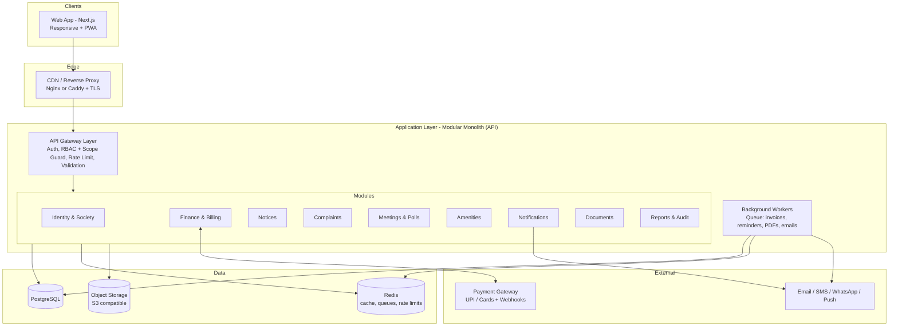
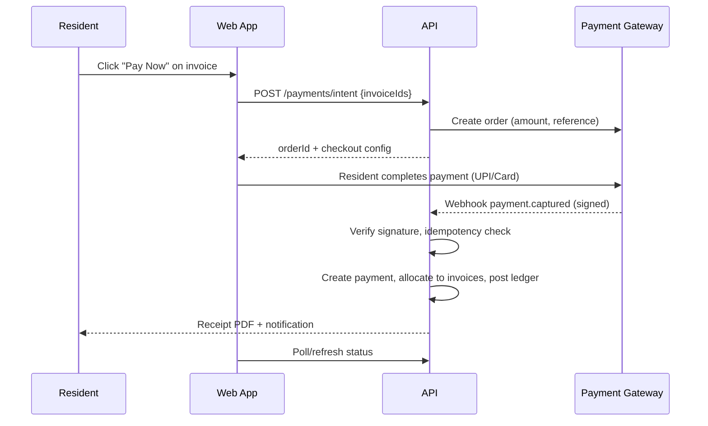
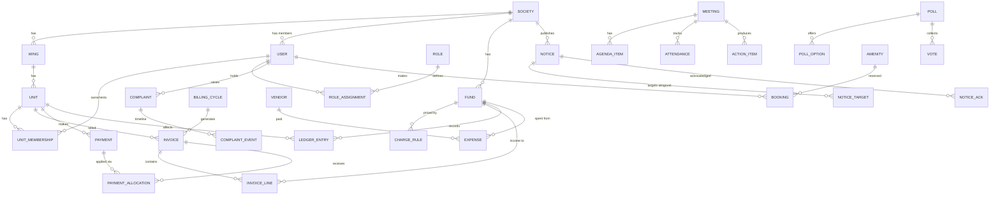
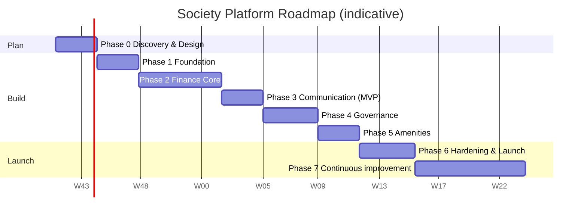

# Society Management Platform — Planning Document

> **Status:** Planning only. No code is written until this document is reviewed and the open decisions in §11 are closed.
> **Working name:** SocietyHub (placeholder)
> **Version:** 0.1 · **Date:** 2026-10-11

---

## Table of Contents

1. [Vision & Summary](#1-vision--summary)
2. [Problem Statement](#2-problem-statement)
3. [Project Analysis](#3-project-analysis)
4. [Proposed Solution](#4-proposed-solution)
5. [System Architecture](#5-system-architecture)
6. [Data Model](#6-data-model)
7. [Frontend: Page Map & Route Mapping](#7-frontend-page-map--route-mapping)
8. [Security, Compliance & Non-Functional Requirements](#8-security-compliance--non-functional-requirements)
9. [Roadmap](#9-roadmap)
10. [Risks & Mitigations](#10-risks--mitigations)
11. [Open Decisions](#11-open-decisions)
12. [Future Scope](#12-future-scope)

---

## 1. Vision & Summary

A single web platform that lets a housing society run its **money, communication, governance and shared facilities** in one place, with:

- **Wing-level isolation**: each wing sees and manages its own data.
- **Society-level oversight**: the chairman and committee see everything across wings.
- **Transparency**: every rupee collected and spent is traceable by residents.
- **Production-grade**: separate, connected pages with proper routing, roles, audit trail and deployment. Not a demo.

---

## 2. Problem Statement

Most societies run on WhatsApp groups, paper receipts, Excel sheets and notice-board paper. This causes:

| # | Problem | Consequence |
|---|---------|-------------|
| P1 | Maintenance billing and collection is manual (Excel / cash / cheque) | Errors, late dues, no single source of truth, hard audits |
| P2 | Funds for maintenance, club and common grounds are not clearly separated | Residents distrust where money goes; disputes at AGM |
| P3 | Residents don't know what they are paying for | Repeated queries to treasurer; low collection rate |
| P4 | Wing-specific matters are mixed into society-wide groups | Noise; important wing notices are missed |
| P5 | Notices, rules and decisions are scattered across chats and paper | No history, no proof of communication, rules get forgotten |
| P6 | Complaints go untracked | No ownership, no SLA, repeat issues, no accountability |
| P7 | Meetings and decisions are informal | No agenda, no minutes, no quorum record; polls are show-of-hands or chat reactions |
| P8 | Amenity use (club, hall, courts) is first-come via phone calls | Double bookings, disputes, no usage or revenue data |
| P9 | Committee turnover loses institutional knowledge | New committee inherits chaos |

**Core problem statement:**

> Housing societies lack a transparent, role-aware, auditable system to manage maintenance finances, wing-level operations, resident communication, governance and amenity usage. This leads to poor collection, low trust and heavy volunteer workload.

---

## 3. Project Analysis

### 3.1 Stakeholders & Roles

| Role | Scope | Typical responsibilities |
|------|-------|--------------------------|
| **Platform Super Admin** | Platform (only if multi-society SaaS) | Onboard societies, support, billing of the platform itself |
| **Chairman** | Society | Full oversight, approvals, announcements, poll/meeting creation |
| **Secretary** | Society | Notices, meetings, minutes, complaint escalation |
| **Treasurer** | Society | Billing, expenses, reconciliation, reports |
| **Wing Representative** | One wing | Manage wing residents, wing notices, wing complaints, wing dues follow-up |
| **Committee Member** | Society (read + limited write) | Vote in committee polls, view reports |
| **Owner** | Own unit | Pay dues, vote, raise complaints, book amenities |
| **Tenant** | Own unit (restricted) | Pay if delegated, raise complaints, book amenities; usually no voting |
| **Staff / Clerk** (optional) | Configured | Record offline payments, manage amenity desk |

> Roles are **scoped assignments**, not fixed user types. One person can be Owner of A-101 *and* Wing Rep of Wing A. See §5.5.

### 3.2 Functional Requirements by Module

#### M1. Identity, Society, Wing & Unit Management
- Society profile, wings, floors, units (flat numbers, area sq ft, type).
- Resident onboarding: invite link / admin-created; owner vs tenant; family members (optional).
- Ownership change and tenant move-in/move-out with history (dues stay with the unit, not the person).
- Login via mobile OTP and/or email + password; session management.

#### M2. Finance
- **Fund / account heads** kept separate: Maintenance, Sinking Fund, Repair Fund, Club, Common Grounds, Parking, Events, Others.
- **Charge configuration**: per head, rules by area (per sq ft), flat rate, unit type, one-time vs recurring.
- **Billing cycles**: monthly/quarterly invoice generation, due date, late fee/interest rule (configurable per bye-laws).
- **Payment breakdown**: every invoice shows line items (e.g. Maintenance ₹x, Sinking ₹y, Club ₹z, Late fee ₹w).
- **Payments**: online (UPI/cards via gateway), and offline (cash/cheque/NEFT) recorded by treasurer with proof.
- **Receipts**: auto-generated PDF receipts, numbered sequentially.
- **Advance payments / credits / adjustments / waivers** with approval and reason.
- **Expenses**: vendor, category, fund head, bill upload, approval workflow (maker-checker).
- **Reports**: collection vs dues, defaulters, fund-wise income/expense, wing-wise collection, monthly/annual statements, exports (CSV/PDF/Excel; Tally export later).
- **Resident view**: "My dues", payment history, downloadable receipts, society-level summary (transparent income/expense dashboard).

#### M3. Wing Portals
- Every resident lands on their **wing dashboard**: wing notices, wing dues snapshot, wing complaints, wing polls.
- Wing Rep admin: residents of wing, wing-level notices/polls, defaulter list for wing, complaint handling for wing.
- Hard data isolation: a Wing A resident cannot read Wing B's wing-scoped data.

#### M4. Admin Section
- Chairman/Committee console: society-wide dashboards, approvals queue, role assignment, audit log, settings, configuration of fees, amenities and policies.
- Wing Rep console: scoped subset of the above.

#### M5. Notice Board
- Categories: **Announcement**, **Decision**, **Rules & Regulations**, **Advertisement / Classified** (needs moderation), **Event**, **Emergency**.
- Targeting: whole society, selected wings, or specific units.
- Pin, expire, schedule publishing, attachments, read receipts / acknowledgement for critical notices.
- Rules & Regulations as a **versioned library** (searchable; history of changes; effective dates).
- Decision log linked to a meeting or poll.

#### M6. Complaint Box
- Raise complaint: category (plumbing, electrical, security, lift, parking, noise, housekeeping, other), unit/wing/common area, photos, priority, **anonymous option** (for sensitive ones).
- Lifecycle: `Open → Acknowledged → In Progress → Resolved → Closed (or Reopened)`.
- Assignment to wing rep / staff / vendor, internal notes vs public comments, SLA timers, escalation to committee.
- Feedback/rating on resolution; analytics (top categories, mean time to resolve).

#### M7. Meetings
- Schedule (AGM / SGM / Committee / Wing meeting), agenda items, venue or online link, invitations and reminders.
- RSVP and attendance, **quorum tracking**, minutes upload/entry, action items with owners and due dates.
- Decisions recorded and published to notice board.

#### M8. Voting & Polls
- Poll types: single choice, multi-choice, yes/no/abstain, ranked (later).
- Eligibility rules: whole society / wing / committee only / owners only; **one vote per unit** (default) or per member (configurable).
- Open/close schedule, secret ballot vs open, results visibility rules, quorum / pass threshold (simple majority, two-thirds).
- Tamper-evident: one vote per eligible voter, immutable after cast (or change allowed until close, configurable), full audit.
- Results exportable and attachable to meeting minutes.

#### M9. Amenities
- Catalog: clubhouse, hall, gym, pool, courts, guest rooms, parking slots, etc.
- Rules per amenity: operating hours, slot length, advance window, max bookings, deposit, fee, blackout dates, resident eligibility (e.g. no dues).
- Booking calendar, conflict-free reservation, cancel/reschedule, approval flow for hall events.
- Fees post to the finance ledger automatically (to the Club / Common fund).
- Usage analytics, maintenance downtime scheduling.

#### M10. Platform & Extensibility ("scope for betterment")
- Notification service (in-app, email, SMS/WhatsApp, push) with per-user preferences.
- Document vault (bye-laws, audit reports, insurance, AMC contracts).
- Feature flags and module toggles per society.
- Versioned API, migration discipline, admin-configurable settings, i18n-ready (English + Hindi/Marathi later).

### 3.3 Non-Functional Requirements (summary)

| Area | Target |
|------|--------|
| Availability | 99.5%+ (billing day peaks matter more than average) |
| Performance | p95 page loads < 2 s on mid-range phones; API p95 < 500 ms |
| Security | RBAC with scope checks on **every** request, audit trail on money and votes |
| Data integrity | Financial records are append-only; corrections are reversing entries |
| Usability | Mobile-first, simple for non-technical, older residents |
| Accessibility | WCAG 2.1 AA targets |
| Maintainability | Modular codebase, ≥70% unit coverage on finance/voting, CI on every PR |
| Backup / DR | Daily backups, tested restore, RPO ≤ 24 h, RTO ≤ 4 h |

### 3.4 Assumptions

1. Start as **one society, multi-wing** and design the schema multi-tenant from day one so it can serve other societies later without rewrite.
2. Payments are in INR, processed via an Indian payment gateway (Razorpay / Cashfree class) with UPI as the primary method.
3. Society is run under a co-operative society or apartment association with bye-laws that define voting rules, late fee/interest, and quorum. These are **configuration**, not hard-coded.
4. Residents mostly use phones, so the UI is **mobile-first responsive**; PWA-installable.

### 3.5 Out of Scope for v1
Visitor/gate management, CCTV integration, accounting double-entry for statutory audit (export only), staff payroll, utility metering (water/electricity), mobile native apps. These are in [Future Scope](#12-future-scope).

---

## 4. Proposed Solution

### 4.1 Design Principles

1. **Scope-first authorization**: every record belongs to a `society`, and optionally a `wing` or `unit`. Every query is filtered by the caller's scopes.
2. **Ledger-first finance**: invoices, payments, expenses and adjustments all produce immutable ledger entries. Balances are *derived*, never hand-edited.
3. **Configuration over code**: fee rules, voting thresholds, late fees and amenity rules live in settings tables.
4. **Everything auditable**: who did what, when, from where, on money, roles, votes and notices.
5. **Modular monolith**: strong module boundaries now; services can split later if needed.
6. **Page-per-concern UI**: separate routed pages with a consistent shell, breadcrumbs and role-based navigation (§7).

### 4.2 How the Solution Addresses the Problems

| Problem | Solution element |
|---------|------------------|
| P1, P3 | Auto-generated invoices with itemised breakdown; online payment; receipts; "My Dues" |
| P2 | Fund heads with separate sub-ledgers and a public transparency dashboard |
| P4 | Wing-scoped portals, notices, polls and complaints |
| P5 | Notice board with categories, targeting, acknowledgements, versioned rules library |
| P6 | Complaint lifecycle with assignment, SLA, escalation and analytics |
| P7 | Meetings with agenda/quorum/minutes; polls with eligibility rules and audit |
| P8 | Amenity catalog and conflict-free booking with auto-billing |
| P9 | Document vault, decision log, audit log, role handover |

---

## 5. System Architecture

### 5.1 High-Level Architecture



### 5.2 Recommended Tech Stack

| Layer | Choice | Why |
|-------|--------|-----|
| Frontend | **Next.js (App Router) + TypeScript + Tailwind + shadcn/ui** | File-based routing maps directly to the page map in §7; SSR for fast loads; strong component ecosystem |
| State / data | TanStack Query + React Hook Form + Zod | Server-state caching, validated forms shared with API schemas |
| Backend | **NestJS (TypeScript)** *(alt: FastAPI)* | Opinionated module structure fits a modular monolith; guards/decorators suit RBAC; one language across stack. FastAPI is a good alternative if you prefer Python and want to add ML features in the same codebase |
| ORM / migrations | Prisma (or TypeORM) | Typed schema, migration history |
| Database | **PostgreSQL** | Relational integrity for money; row-level security option; JSONB for settings |
| Cache / queue | Redis + BullMQ | Invoice runs, reminders, PDF generation, rate limiting |
| File storage | S3-compatible (AWS S3 / Cloudflare R2 / MinIO in dev) | Bills, receipts, attachments, documents |
| Auth | JWT (short-lived) + refresh tokens in httpOnly cookies; OTP via SMS/email | Mobile-number-first fits residents |
| Payments | Razorpay / Cashfree (webhook-driven) | UPI-first, settlement reports |
| Notifications | Email (SES/Resend), SMS/WhatsApp (provider TBD), Web Push | Preference-based |
| DevOps | Docker, GitHub Actions, Nginx/Caddy; Sentry + Prometheus/Grafana (or managed equivalents) | Reproducible deploys, observability |
| Testing | Vitest/Jest, Supertest, Playwright (E2E) | Covers money/vote flows end-to-end |

> The stack is a recommendation and not a lock. Whatever is chosen, the **boundaries and data model below stay the same**.

### 5.3 Backend Module Structure (modular monolith)

```
apps/
  web/                    # Next.js frontend
  api/                    # NestJS backend
    src/
      common/             # guards, decorators, interceptors, errors, pagination
      modules/
        identity/         # users, auth, sessions, OTP
        society/          # society, wings, units, memberships, roles
        finance/
          charges/        # fund heads, charge rules
          billing/        # cycles, invoices, late fees
          payments/       # gateway, offline payments, receipts
          expenses/       # vendors, bills, approvals
          ledger/         # immutable ledger + balances
          reports/
        notices/
        complaints/
        meetings/
        polls/
        amenities/
        notifications/
        documents/
        audit/
      jobs/               # queue processors
packages/
  shared/                 # zod schemas, types, constants (used by web + api)
  ui/                     # shared component library (optional)
infra/
  docker/ nginx/ ci/
docs/
```

**Rules for modules:** a module exposes a service interface; other modules call that interface, never each other's tables directly. Cross-module reactions use internal events (e.g. `AmenityBooked → finance.postCharge`, `PollClosed → notices.publishDecision`).

### 5.4 Multi-Tenancy & Wing Isolation

- Every table that holds society data carries `society_id`. Wing-scoped records also carry `wing_id` (nullable → society-wide).
- A **Scope Guard** runs on every request:
  1. Resolve the user's role assignments → set of `(role, scope_type, scope_id)`.
  2. Check that the action's permission is granted for the target resource's scope.
  3. Apply automatic query filters (`society_id = ?` and `wing_id IN (?)` where relevant).
- **Defence in depth:** enable PostgreSQL Row-Level Security keyed on `society_id` so a bug in application code cannot leak across societies.

### 5.5 Authorization Model (RBAC with scopes)

Role assignment = `(user, role, scope_type, scope_id)` where `scope_type ∈ {SOCIETY, WING, UNIT}`.

| Capability | Chairman | Secretary | Treasurer | Wing Rep | Owner | Tenant |
|------------|:--------:|:---------:|:---------:|:--------:|:-----:|:------:|
| View society dashboard / finance summary | ✔ | ✔ | ✔ | ✔ (read) | ✔ (summary) | ✔ (summary) |
| Configure fund heads, charges, billing | ✔ | – | ✔ | – | – | – |
| Generate invoices / record offline payment | ✔ | – | ✔ | – | – | – |
| Approve expenses | ✔ | – | ✔ (maker) | – | – | – |
| View own unit dues, pay | – | – | – | – | ✔ | ✔ (if allowed) |
| View wing-wide dues / defaulters | ✔ | ✔ | ✔ | ✔ (own wing) | – | – |
| Publish society-wide notice | ✔ | ✔ | – | – | – | – |
| Publish wing notice | ✔ | ✔ | – | ✔ (own wing) | – | – |
| Submit advertisement (moderated) | – | – | – | – | ✔ | ✔ |
| Raise complaint | ✔ | ✔ | ✔ | ✔ | ✔ | ✔ |
| Manage wing complaints | ✔ | ✔ | – | ✔ (own wing) | – | – |
| Schedule meetings | ✔ | ✔ | – | ✔ (wing meetings) | – | – |
| Create polls | ✔ | ✔ | – | ✔ (wing polls) | – | – |
| Vote | per eligibility rules | | | | ✔ (owners) | configurable |
| Manage amenities & rules | ✔ | ✔ | – | – | – | – |
| Book amenity | ✔ | ✔ | ✔ | ✔ | ✔ | ✔ |
| Manage roles, audit log, settings | ✔ | – | – | – | – | – |

> Permissions are stored as data (`role → permission[]`) so the committee can adapt without a code deploy. The table above is the **default seed**.

### 5.6 Finance Architecture (the part that must be right)

**Ledger design.** Every monetary event writes one or more rows to `ledger_entries` (append-only):

| Event | Ledger effect |
|-------|---------------|
| Invoice issued | Debit *Unit Receivable*, Credit *Fund Income* (per line / fund head) |
| Payment received | Debit *Bank/Gateway*, Credit *Unit Receivable* |
| Late fee applied | Debit *Unit Receivable*, Credit *Late Fee Income* |
| Waiver / adjustment | Reversing or adjusting entry with reason + approver |
| Expense paid | Debit *Fund Expense*, Credit *Bank/Cash* |
| Amenity fee | Debit *Unit Receivable* (or collect immediately), Credit *Club/Common fund* |

- Unit balance = sum of ledger entries for the unit, so no mutable "balance" column to drift.
- Corrections are **reversals**, never edits or deletes.
- Each fund head has its own running balance, which satisfies the "separate finances for maintenance / club / common grounds" requirement.

**Billing run (scheduled job):**
```
cron (per cycle) → for each active unit → apply charge rules → create invoice + lines
                 → post ledger entries → generate PDF → notify resident
```
Idempotent (unique key `unit_id + cycle_id`) so re-runs never double-bill.

**Online payment flow:**

Key rules: **trust only the webhook**, never the browser redirect. Verify signatures, dedupe by gateway payment ID, and run a nightly reconciliation job against gateway settlement reports.

**Payment allocation order** (configurable): oldest invoice first; within an invoice, late fees → interest → fund heads in priority order.

**Controls:** maker-checker on expenses/waivers above a threshold; period locking (close a month so past entries cannot change); audit log on all finance writes.

> GST applicability on maintenance charges and interest/late-fee caps depend on bye-laws and current law. Keep these as configuration and confirm with the society's accountant/CA before go-live.

### 5.7 Notification Architecture

```
Domain event ──► Notification Service ──► Template + preference check ──► Channel adapters (in-app / email / SMS / WhatsApp / push)
                                         └─► Delivery log + retry with backoff
```
Triggers: invoice generated, due reminder (T-5, T-1, overdue), payment received, notice published (targeted), complaint status change, meeting invite/reminder, poll open/closing, booking confirmation.

### 5.8 API Design

- REST, JSON, versioned: `/api/v1/...`, OpenAPI spec generated from code.
- Resource-oriented, consistent pagination/filter/sort, standard error envelope with error codes.
- Scope-aware routes, for example:

```
GET    /api/v1/wings/:wingId/notices
POST   /api/v1/notices                     (scope in body: society | wings[] | units[])
GET    /api/v1/units/:unitId/invoices
POST   /api/v1/payments/intent
POST   /api/v1/webhooks/payments           (public, signature-verified)
GET    /api/v1/finance/funds/:fundId/ledger
POST   /api/v1/polls/:pollId/votes
GET    /api/v1/amenities/:id/availability?date=
POST   /api/v1/complaints
PATCH  /api/v1/complaints/:id/status
```

### 5.9 Deployment Architecture

| Environment | Purpose |
|-------------|---------|
| Local | Docker Compose: web, api, postgres, redis, minio, mailhog |
| Staging | Mirrors production, test gateway keys, seeded demo society |
| Production | Containerised API + web, managed PostgreSQL with backups, Redis, object storage, CDN/TLS |

- CI/CD: PR → lint + typecheck + unit tests → build images → deploy to staging → E2E smoke → manual approval → production.
- Config via environment variables / secrets manager. No secrets in the repo.
- DB migrations run as a deploy step; backwards-compatible migrations only (expand → migrate → contract).
- Observability: structured logs with request IDs, error tracking (Sentry), metrics + alerts (failed webhooks, job failures, payment mismatch, 5xx rate).

---

## 6. Data Model

### 6.1 Entity Relationship Overview



### 6.2 Key Tables (essentials)

| Table | Key columns / notes |
|-------|---------------------|
| `societies` | id, name, registration_no, address, settings (JSONB), timezone, currency |
| `wings` | id, society_id, name, floors |
| `units` | id, society_id, wing_id, number, floor, area_sqft, type, status |
| `users` | id, society_id, name, mobile (unique), email, status, last_login |
| `unit_memberships` | user_id, unit_id, relation (OWNER/TENANT/FAMILY), start_date, end_date, can_vote, can_pay |
| `roles`, `permissions`, `role_permissions` | seeded defaults, editable |
| `role_assignments` | user_id, role_id, scope_type (SOCIETY/WING/UNIT), scope_id, valid_from, valid_to |
| `funds` | id, society_id, name (Maintenance/Sinking/Club/…), type, active |
| `charge_rules` | fund_id, basis (FLAT/PER_SQFT/UNIT_TYPE), amount, frequency, effective_from/to |
| `billing_cycles` | id, period_start, period_end, due_date, status (DRAFT/ISSUED/CLOSED) |
| `invoices` | id, unit_id, cycle_id, number, total, status, **unique(unit_id, cycle_id)** |
| `invoice_lines` | invoice_id, fund_id, description, amount |
| `payments` | id, unit_id, method, amount, gateway_ref (unique), status, received_at, recorded_by, proof_url |
| `payment_allocations` | payment_id, invoice_id, amount |
| `ledger_entries` | id, society_id, unit_id?, fund_id, account, debit, credit, ref_type, ref_id, posted_at, **append-only** |
| `expenses` | id, fund_id, vendor_id, amount, bill_url, status, maker_id, approver_id |
| `notices` | id, society_id, category, title, body, pinned, publish_at, expire_at, status, version |
| `notice_targets` | notice_id, wing_id?, unit_id? (none → society-wide) |
| `complaints` | id, unit_id?, wing_id?, category, priority, anonymous, status, assignee_id, sla_due_at |
| `complaint_events` | complaint_id, actor_id, type (COMMENT/STATUS/ASSIGN), visibility, payload |
| `meetings` | id, type, scope, scheduled_at, venue, agenda, minutes_url, quorum_required |
| `polls`, `poll_options`, `votes` | poll rules JSONB (eligibility, threshold, secret); **unique(poll_id, voter_unit_id)** |
| `amenities`, `amenity_rules`, `bookings` | booking with exclusion constraint on (amenity_id, time range) |
| `documents` | id, category, version, file_url, visibility scope |
| `notifications`, `notification_prefs` | channel, template, status, retries |
| `audit_logs` | actor, action, entity, before/after, ip, user_agent, timestamp |

**Integrity notes:** money as `NUMERIC(12,2)` or integer paise (never float); DB exclusion constraint prevents overlapping bookings; unique constraints enforce one vote per voter and one invoice per unit per cycle.

---

## 7. Frontend: Page Map & Route Mapping

The UI is built as **separate routed pages** under role-aware layouts. Next.js route groups map 1:1 to this structure.

### 7.1 Layout Structure

```
(public)      → marketing/login layout, no sidebar
(resident)    → resident shell: top bar + bottom nav (mobile) / sidebar (desktop)
(admin)       → admin shell: sidebar with module nav, breadcrumbs, approvals badge
```
Navigation items are filtered by the user's permissions; direct URL access is also guarded server-side.

### 7.2 Route Tree

```
PUBLIC
/                                   Landing / society info
/login                              Mobile OTP / email login
/onboarding/:inviteToken            Accept invite, set profile
/forgot-password
/403  /404  /500                    Error pages

RESIDENT  (prefix: /app)
/app                                Home dashboard (dues snapshot, latest notices, upcoming meetings, open polls)
/app/wing                           My wing hub
  /app/wing/notices                 Wing notices
  /app/wing/members                 Wing directory (privacy-aware)
  /app/wing/polls                   Wing polls
/app/finance
  /app/finance/dues                 My dues & pay now
  /app/finance/invoices             Invoice list
  /app/finance/invoices/:id         Invoice detail with itemised breakdown
  /app/finance/payments             Payment history
  /app/finance/receipts/:id         Receipt view / download
  /app/finance/transparency         Society income & expense summary by fund
/app/notices
  /app/notices                      Board (filter: category, wing, pinned)
  /app/notices/:id                  Notice detail + acknowledge
  /app/notices/rules                Rules & regulations library
  /app/notices/rules/:id            Rule detail + version history
  /app/notices/classifieds          Advertisements
  /app/notices/classifieds/new      Submit an ad (moderated)
/app/complaints
  /app/complaints                   My complaints
  /app/complaints/new               Raise complaint
  /app/complaints/:id               Timeline, comments, rate resolution
/app/meetings
  /app/meetings                     Upcoming & past
  /app/meetings/:id                 Agenda, RSVP, minutes, decisions
/app/polls
  /app/polls                        Open / closed
  /app/polls/:id                    Vote / view results
/app/amenities
  /app/amenities                    Catalog
  /app/amenities/:id                Details, rules, availability calendar
  /app/amenities/:id/book           Book slot
  /app/amenities/bookings           My bookings
/app/documents                      Document vault (bye-laws, reports)
/app/profile                        Profile, family, vehicles, contact preferences
/app/notifications                  Inbox + preferences

ADMIN  (prefix: /admin) — visible by role/scope
/admin                              Admin dashboard (collection %, open complaints, approvals, upcoming meetings)
/admin/society
  /admin/society/profile            Society settings
  /admin/society/wings              Wings list / create
  /admin/society/wings/:wingId      Wing detail (units, residents, rep)
  /admin/society/units              Units & ownership history
  /admin/society/residents          Residents, invites, bulk import
  /admin/society/roles              Roles & assignments
/admin/finance
  /admin/finance/overview           Funds, balances, collection summary
  /admin/finance/funds              Fund heads
  /admin/finance/charges            Charge rules
  /admin/finance/billing            Billing cycles, preview & issue
  /admin/finance/invoices           All invoices (filter by wing/unit/status)
  /admin/finance/payments           Payments, record offline, reconcile
  /admin/finance/dues               Defaulters & reminders
  /admin/finance/expenses           Expenses list
  /admin/finance/expenses/new       Add expense + bill
  /admin/finance/approvals          Approval queue (maker-checker)
  /admin/finance/vendors            Vendors
  /admin/finance/reports            Reports & exports
  /admin/finance/ledger             Ledger explorer
/admin/notices                      Manage notices (create, schedule, target, moderate ads)
/admin/rules                        Manage rules library & versions
/admin/complaints                   Queue, assign, SLA, analytics
/admin/meetings                     Schedule, agenda, attendance, minutes, action items
/admin/polls                        Create/manage polls, results, export
/admin/amenities                    Catalog, rules, bookings, blackout dates, usage
/admin/documents                    Upload/manage documents
/admin/notifications                Templates & delivery log
/admin/audit                        Audit log
/admin/settings                     Feature toggles, policies, integrations
```

> Wing Reps see the same `/admin/*` pages but with **wing-filtered data and reduced actions** (enforced by the API, not just hidden in the UI).

### 7.3 Navigation & Flow Mapping (key journeys)

| Journey | Path |
|---------|------|
| Pay maintenance | `/app` → `/app/finance/dues` → invoice detail → gateway → `/app/finance/receipts/:id` |
| Raise & track complaint | `/app/complaints/new` → `/app/complaints/:id` (status updates + notifications) |
| Hold an AGM | `/admin/meetings` (create) → notice auto-posted → RSVP at `/app/meetings/:id` → attendance/quorum → minutes → decision on `/app/notices` |
| Run a vote | `/admin/polls` (create, set eligibility) → `/app/polls/:id` (vote) → close → results → linked to meeting minutes |
| Book clubhouse | `/app/amenities/:id` → `/app/amenities/:id/book` → fee posted to Club fund → confirmation |
| Monthly billing | `/admin/finance/billing` (preview → issue) → notifications → collections tracked at `/admin/finance/dues` |

### 7.4 UI/UX Deliverables Before Coding

1. Information architecture / sitemap (this section, refined).
2. Low-fi wireframes for each page group, mobile first.
3. Design system: colours, typography, spacing, components (tables, forms, status chips, calendars, charts), empty/loading/error states.
4. Clickable prototype (Figma) for: Home, Dues & Pay, Notice Board, Complaint, Poll, Admin Billing.
5. Usability test with 5–8 real residents (including older users).

---

## 8. Security, Compliance & Non-Functional Requirements

**Authentication & sessions**
- OTP + optional password, rate-limited, lockout on abuse; short-lived access tokens, rotating refresh tokens; device/session list with revoke.

**Authorization**
- Central Scope Guard (§5.4); deny by default; automated tests for cross-wing and cross-society access attempts.

**Data protection**
- TLS everywhere; encryption at rest for DB and object storage; signed, expiring URLs for private files.
- PII minimisation (mobile/email visibility rules in directory); follow India's **DPDP Act** principles: consent, purpose limitation, ability to correct/delete (subject to financial-record retention).
- Never store card details (gateway-hosted checkout only).

**Application security**
- Input validation (Zod/DTOs) on every endpoint; parameterised queries; output encoding; CSRF protection for cookie auth; strict CORS; security headers (CSP, HSTS); file upload scanning/type+size limits; dependency scanning in CI.

**Integrity**
- Append-only ledger, period locking, idempotency keys on payments/votes/billing, audit log immutable (write-only table).

**Privacy of voting**
- Secret ballots store the vote separately from voter identity (record only *that* a unit voted), while still enforcing one-vote-per-unit.

**Operations**
- Backups + restore drills, uptime/health checks, alerting, runbooks, incident log.

---

## 9. Roadmap

> Timeline assumes a small team (2–3 developers) working steadily. Adjust ×1.5–2 for a solo or part-time team. Each phase ends with a **demo + exit criteria**, and nothing moves forward until exit criteria are met.

### Phase 0 — Discovery & Design (Weeks 1–3)
**Goal:** Remove ambiguity before writing production code.
- Interview chairman, treasurer, 2–3 wing reps, 5–8 residents; collect real artefacts (bye-laws, maintenance sheet, sample notices, past polls).
- Confirm decisions in §11; define fund heads, charge formulas, late-fee rules, voting rules.
- Finalise sitemap, wireframes, design system, clickable prototype; usability test.
- Finalise data model v1 and API contract draft (OpenAPI).
- Set up repo, branching strategy, coding standards, Definition of Done.

**Exit:** signed-off prototype, data model, requirements baseline, prioritised backlog.

### Phase 1 — Foundation (Weeks 4–6)
- Monorepo, Docker Compose dev env, CI pipeline, staging environment.
- Auth (OTP/email), sessions, user & profile.
- Society → Wing → Unit → Membership; resident invite & onboarding; bulk import (CSV).
- RBAC + Scope Guard + audit logging + role assignment UI.
- App shells (public / resident / admin), navigation, design-system components, error pages.

**Exit:** a seeded society where a wing rep sees only their wing; automated cross-wing access tests pass.

### Phase 2 — Finance Core (Weeks 7–12)
- Funds, charge rules, billing cycles, invoice generation (idempotent), PDF invoices/receipts.
- Ledger and balances; resident "My Dues", invoice detail with breakdown.
- Offline payment recording + online payments (gateway sandbox → live), webhooks, reconciliation job.
- Late fees, reminders, defaulter list; expenses with approvals; vendor management.
- Reports (collection, dues, fund-wise statement) and transparency dashboard.
- Finance E2E tests; parallel run against the society's existing Excel for 1–2 cycles.

**Exit:** two consecutive billing cycles match the manual books to the rupee; webhook replay/duplicate tests pass.

### Phase 3 — Communication (Weeks 13–15)
- Notice board (categories, targeting, scheduling, pinning, acknowledgement, attachments).
- Rules & regulations library with versions; advertisement moderation.
- Complaint box with lifecycle, assignment, SLA, comments, photos, anonymous option.
- Notification service (in-app + email first; SMS/WhatsApp next).

**Exit:** wing-targeted notices delivered correctly; complaint can travel Open → Closed with notifications.

### 🚩 MVP Release (end of Phase 3, ≈ week 15)
Pilot with 1–2 wings → collect feedback → then society-wide.

### Phase 4 — Governance (Weeks 16–19)
- Meetings: scheduling, agenda, RSVP, attendance, quorum, minutes, action items.
- Polls & voting with eligibility, one-vote-per-unit, secret/open modes, thresholds, results export.
- Decision log tied to meetings/polls and auto-published to notice board.

**Exit:** a full mock AGM (invite → quorum → vote → minutes → decision notice) with audit trail.

### Phase 5 — Amenities (Weeks 20–22)
- Catalog and rules; availability calendar; conflict-free booking (DB constraint); cancellation policies.
- Fee/deposit posting into the ledger; approvals for hall events; downtime scheduling; usage analytics.

**Exit:** concurrent booking test shows zero double-bookings; fees reconcile to Club fund.

### Phase 6 — Hardening & Launch (Weeks 23–26)
- Security review + penetration test (OWASP checklist), load test on billing/payment peak.
- Accessibility audit, performance tuning (Core Web Vitals), PWA install, SEO/meta for public pages.
- Backup/restore drill, monitoring dashboards and alerts, runbooks, data-retention policy.
- Resident & committee training, user guide, FAQ, in-app onboarding tour.
- Go-live plan with rollback; hypercare for 2 billing cycles.

**Exit:** all launch-checklist items green; sign-off from chairman & treasurer.

### Phase 7 — Post-Launch: Maintenance & Improvement (continuous)
- **Cadence:** fortnightly releases, monthly retro with committee, quarterly roadmap review.
- **Maintenance:** dependency updates, security patches, backup tests, cost review, bug SLAs (P1 < 4 h, P2 < 2 days).
- **Feedback loop:** in-app feedback, usage analytics, complaint-tool metrics → backlog.
- Then pick from [Future Scope](#12-future-scope).

### Roadmap at a Glance



### Definition of Done (every feature)
Code reviewed · unit + integration tests · permission tests for each role · audit logging where relevant · responsive & accessible UI · empty/loading/error states · docs updated · deployed to staging and verified.

---

## 10. Risks & Mitigations

| Risk | Impact | Mitigation |
|------|--------|-----------|
| Requirements vary by society/bye-laws | Rework | Rules as configuration; validate in Phase 0 |
| Financial calculation errors | Loss of trust | Ledger-first design, parallel run with Excel, heavy finance tests |
| Low resident adoption (esp. older residents) | Project fails despite working software | Mobile-first simple UI, WhatsApp/SMS notifications, offline payment option, training, wing reps as champions |
| Cross-wing data leak | Privacy breach | Scope Guard + RLS + automated access tests |
| Payment gateway failure/dupes | Wrong balances | Webhook-only truth, idempotency, nightly reconciliation |
| Voting disputes | Legal/social conflict | Clear eligibility rules, audit trail, exportable evidence, secret ballot design |
| Committee turnover | Knowledge loss | Documents, decision log, handover checklist, role history |
| Scope creep | Delays | MVP boundary, phase exit criteria, backlog triage with committee |
| Single-developer dependency | Bus factor | Documentation, ADRs, simple standard stack |
| Running costs | Budget | Start on small managed infra; cost dashboard; per-society pricing model if SaaS |

---

## 11. Open Decisions

Please confirm or adjust before Phase 0 ends:

1. **Single society or multi-society SaaS?** (Schema supports both; affects super-admin, billing and branding work.)
2. **Voting unit:** one vote per flat or per member? Can tenants vote? Proxy voting allowed?
3. **Billing model:** flat vs per-sq-ft vs mixed; billing frequency; late-fee/interest rule; GST treatment.
4. **Payment methods:** online via gateway at launch, or offline recording first?
5. **Which funds** exist exactly (maintenance, sinking, repair, club, parking, others)? Any fund restrictions?
6. **Notification channels:** is WhatsApp/SMS budget available, or email + in-app only for MVP?
7. **Advertisement policy:** free, paid, or committee-approved only? Who moderates?
8. **Anonymous complaints:** allowed? Who can de-anonymise?
9. **Data migration:** is there historical data (dues, residents, payments) to import?
10. **Hosting & budget:** preferred cloud, region (India), monthly budget.
11. **Languages:** English only at launch, or Hindi/Marathi as well?
12. **Branding:** society/product name, logo, colours.
13. **Team and timeline:** who builds, how many hours per week, target pilot date?

---

## 12. Future Scope

| Theme | Ideas |
|-------|-------|
| **Operations** | Visitor & gate management (QR passes), staff attendance, vehicle/parking management, delivery tracking |
| **Finance** | Tally/accounting export, GST invoices, bank statement auto-reconciliation, budgeting vs actuals, AMC/vendor contract tracking |
| **Communication** | WhatsApp bot, push notifications, multilingual notices, community directory & classifieds marketplace |
| **Governance** | E-AGM with video link, digital signatures on minutes, ranked-choice voting |
| **Smart features (AI/ML)** | Complaint auto-categorisation and priority, bye-law Q&A chatbot (RAG over the rules library), defaulter-risk prediction and smart reminder timing, expense anomaly detection, demand forecasting for amenities |
| **Platform** | Native mobile apps, multi-society SaaS with plans/billing, public API/webhooks, IoT (water/electricity metering, smart locks) |
| **Sustainability** | Waste/segregation tracking, solar/energy dashboards |

---

### Appendix A — Suggested Repo Documents (to create in Phase 0)

```
docs/
  01-requirements.md        # baseline + prioritised backlog
  02-architecture.md        # this document, kept current
  03-data-model.md          # ERD + dictionary
  04-api-contract.yaml      # OpenAPI
  05-ui-sitemap-wireframes/ # Figma links + exports
  06-rbac-matrix.md
  07-finance-rules.md       # charges, late fees, allocation, GST decisions
  08-runbook.md             # deploy, backup/restore, incident response
  adr/                      # architecture decision records (one file per decision)
```

### Appendix B — Glossary

| Term | Meaning |
|------|---------|
| Wing | A building/block within the society |
| Unit | A flat/apartment (billing and voting entity) |
| Fund head | A separate pot of money (Maintenance, Sinking, Club…) |
| Ledger | Append-only record of every money movement |
| Scope | The boundary (society / wing / unit) a role or record applies to |
| Maker-checker | One person creates, another approves |
| Idempotent | Safe to run twice without double effect |
